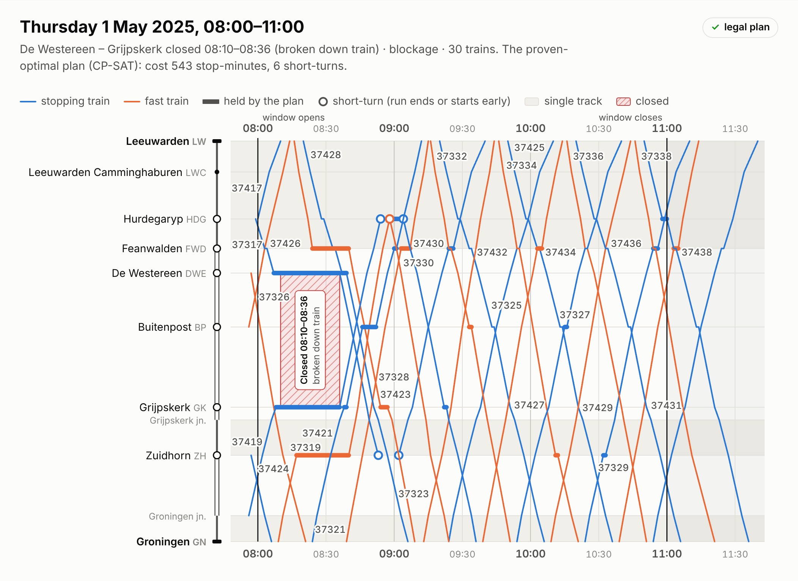
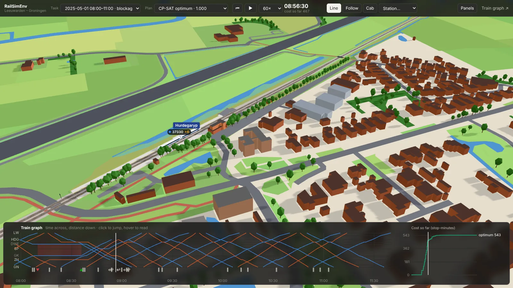
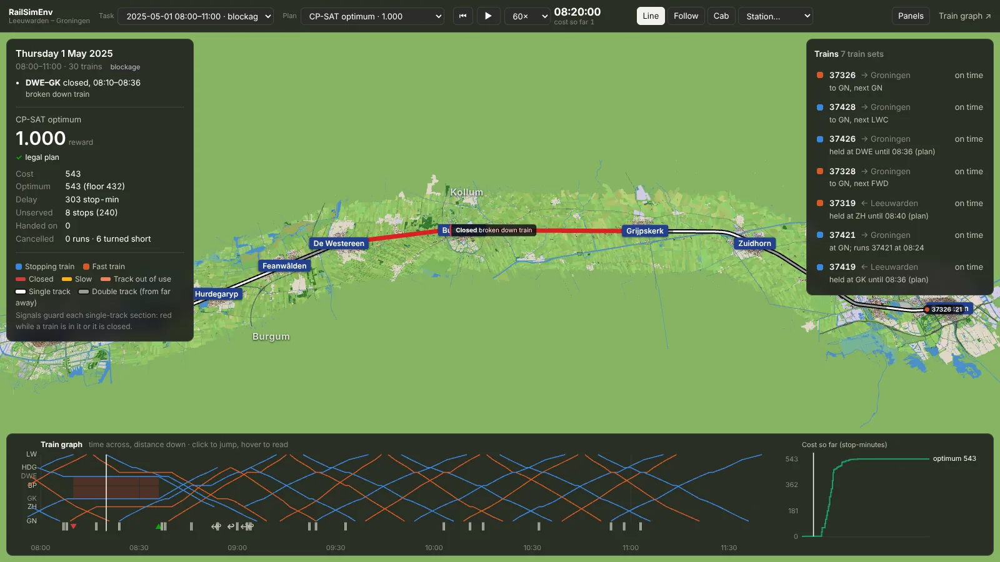
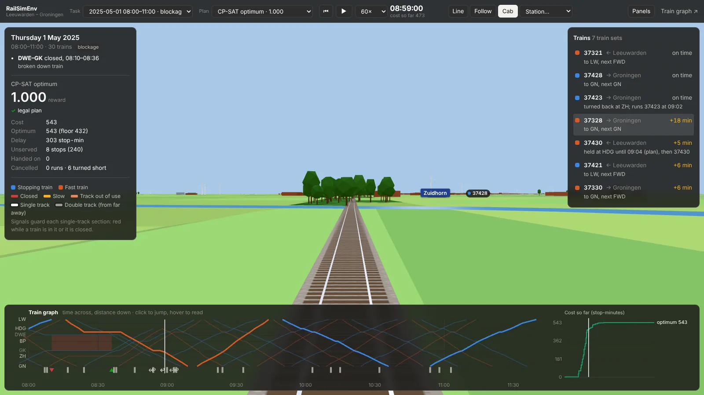

<div align="center">



<h1>RailSimEnv v1</h1>

<h3>Dispatch the trains on a single-track Dutch line after a real 2025 disruption</h3>

<p>An OpenEnv environment built from the public record of every train between Leeuwarden and Groningen (January-June
2025: timetables, real delays, real breakdowns, collisions and signal failures), graded deterministically against a
proven optimum. Its eval set is chosen for hardness.</p>

</div>

---

## The task

The agent is Arriva's train dispatcher (treindienstleider) for the Groningen - Leeuwarden line. The line is 55 km of
mostly single track: trains going opposite ways can only pass at stations with two tracks or on the double-track
parts. Eight trains an hour (stopping and fast, both directions) share the single track out of Leeuwarden.

Something has gone wrong:
- **From the record:** a broken-down train, a collision at a level crossing, a signal or points failure, on its real
  day and time, with every train where it really was when it happened.
- **Drawn from the 2024-2025 record:** closures, lost passing tracks, slow running and late train sets on other
  days.

It decides, for every train it wants to change:

| lever | |
|---|---|
| `hold` | wait at a station until a minute (let an opposing train through, wait out a closure) |
| `to` / `from` | short-turn a train at Hurdegaryp, Buitenpost or Zuidhorn, and start its next run from there |
| `cancel` | do not run it (its train set stays where it is) |

Trains it leaves alone run as early as the physics allow, and never ahead of the timetable.

| tool | what it does |
|---|---|
| `get_situation()` | the line, the closures, every train's timetable and position, the train sets and their chains of runs |
| `check_plan(plan)` | simulates a draft: every train's times, delay and lost stops, every rule broken, the cost; 10 per episode |
| `submit_plan(plan)` | ends the episode with one grade |

**Rules:**
- no two opposing trains in a single-track section at once;
- 3-minute headways for trains going the same way, so no overtaking between stations;
- never more trains at a station than tracks (the terminals have room for every set);
- no train in a closed section;
- runs start where their train set is, and every set ends the window where its next run leaves;
- no stop more than 2 hours late.

**Cost**, in stop-minutes:
- every minute of delay at every stop served;
- 30 per stop not served;
- lateness handed on to the next window.

**Reward:**
- A plan that breaks a rule scores below 0.2.
- A valid plan scores `0.2 + 0.8·e^(−gap/0.5)`, the gap measured against the cost a dispatcher controls, so the optimum
  scores 1.0.

## Results

Four models on the 45 eval tasks, one rollout each, under the same rules (12 turns, 64k output tokens per turn):
Claude Sonnet 5.5 at effort high (`results/rollouts/2026-10-07-sonnet-5-5-eval45`), and three open models through
Hugging Face's router: Qwen3.8-2.4T-A95B on Together (`results/rollouts/2026-10-08-qwen3-8-2-4t-eval45`),
DeepSeek-V4.1-Flash on Baseten (`results/rollouts/2026-10-08-deepseek-v4-1-flash-eval45`) and GLM-5.3-Flash on
Together (`results/rollouts/2026-10-08-glm-5-3-flash-eval45`):

| Model | n | Mean reward (95% CI) | real | blockage | loop | compound | Feasible | Optimal | Beat the real dispatchers (real tier) | Ended without submit |
|---|---:|---|---:|---:|---:|---:|---:|---:|---:|---:|
| Qwen/Qwen3.8-2.4T-A95B (Together) | 45 | **0.556** (0.452-0.665) | 0.546 | 0.481 | 0.787 | 0.593 | 87% | 27% | 3 of 4 | 0 |
| deepseek-ai/DeepSeek-V4.1-Flash (Baseten) | 45 | **0.534** (0.427-0.643) | 0.578 | 0.429 | 0.685 | 0.611 | 73% | 27% | 2 of 4 | 0 |
| claude-sonnet-5-5@high | 45 | **0.467** (0.384-0.553) | 0.457 | 0.421 | 0.538 | 0.507 | 100% | 9% | 2 of 4 | 0 |
| zai-org/GLM-5.3-Flash (Together) | 45 | **0.360** (0.251-0.477) | 0.420 | 0.278 | 0.250 | 0.468 | 53% | 13% | 1 of 4 | 16 |

Claude Sonnet 5.5 never breaks a rule but rarely finds the optimum:
- **Below 0.7 on 33 of 45 tasks**; median 0.325. Sonnet reaches the proven optimum on 4.
- **Every plan was legal.** The losses are decisions: feasible plans cost 17 % more than the optimum (median; 42 % mean).
- Summed over all tasks, against the optimum, the plans carry:
  - 7,800 extra delay-minutes and 2,880 in unserved stops;
  - 37 more cancellations and 80 fewer short-turns. Sonnet cancels whole trains where the optimum turns them.
- **Speed:** a median of 6 turns and 4.4 minutes per episode.

Qwen3.8-2.4T submits every time and reaches the optimum most often:
- **All 45 episodes submitted**, 39 plans legal, **12 at the proven optimum** (Sonnet 4). It tests draft after draft
  with `check_plan` (median 11 turns, against Sonnet's 6).
- **Head to head it is close to Sonnet** (22 tasks better, 20 worse, 3 tied); its lead comes from the optimal plans
  and the `loop` tier (0.787). It loses on 6 illegal plans and a tail of legal but costly ones.
- **Speed:** 21 minutes per episode (median), the slowest of the four. Run 20 wide: at 47 streams Together
  rate-limited the run. See the run's `analysis.md`.

DeepSeek-V4.1-Flash is nearly as good as Qwen in half the time:
- **All 45 submitted, 12 at the proven optimum** (as many as Qwen); legal plans cost 4 % more than the optimum
  (median; 17 % mean, the tightest of the four). It loses on legality: **12 plans break a rule** (Qwen 6, Sonnet 0).
- **Head to head:** even with Sonnet (20 better, 20 worse, 5 tied), behind Qwen (13 / 22 / 10).
- **Speed:** 10.5 minutes per episode (median) at about 300-370 tokens/s. The router paused Baseten 126 times during
  the run; the harness waited each pause out.

GLM-5.3-Flash loses mostly by never submitting:
- **16 of 45 episodes ended without a plan**, each after two turns in a row cut at the 64k output limit. GLM tries to
  simulate the timetable by hand instead of testing drafts with `check_plan`; 96 of its 275 turns hit the limit.
- **When it submits, it matches Sonnet:** 0.559 on those 29 tasks (Sonnet 0.509). 24 of the 29 plans are legal, 6 are
  optimal, and legal plans cost 6 % more than the optimum (median; Sonnet 17 %).
- **Speed:** 27 minutes per episode (median) at about 100 tokens/s.
- 8 episodes lost to infrastructure (6 proxy connection drops, 2 cut by a wall clock that never bound Sonnet) were
  rerun. See the run's `analysis.md`.

The same tasks under the lazy policies (the stored optimum scores 1.0 by construction):

| policy | mean reward | real | blockage | loop | compound | feasible |
|---|---:|---:|---:|---:|---:|---:|
| CP-SAT optimum (the reference) | **1.000** | 1.000 | 1.000 | 1.000 | 1.000 | 100% |
| the real dispatchers (the record's outcome, real tier only, scored as if legal) | **0.502** | 0.502 | - | - | - | - |
| greedy dispatcher (first come first served, short-turn before long closures) | **0.180** | 0.187 | 0.170 | 0.226 | 0.179 | 58% |
| naive: change nothing | **0.105** | 0.127 | 0.112 | 0.122 | 0.086 | 0% |

- **The eval set** has 45 tasks on 27 held-out days, 15-38 runs each (median 26), all proven optimal.
- **How it was chosen.** It is the hardest 45 of a 72-task pool, chosen by a hardness predictor fitted to Sonnet's
  rewards on 16 *train* tasks. No model saw an eval task before selection.
  - On those train tasks Sonnet averaged 0.557. The predictor expected 0.443 on the chosen 45; Sonnet scored 0.467.
  - Ranking *within* the 45 did not validate: Spearman 0.08 between predicted and actual. The selection's effect is
    mostly the mix: fewer passing-track (`loop`) tasks, which are easier, and more closures.
  - Most of the difficulty is the environment itself. See [DESIGN.md](DESIGN.md#choosing-hard-eval-tasks) and
    `results/rollouts/2026-10-07-sonnet-5-5-eval45/analysis.md`.
- **Train split:** 159 tasks on 84 other days, all proven optimal.
- **Read one episode** tool by tool in [results/example_episode.md](results/example_episode.md).

## Watch a plan run



`/twin/` replays any plan on a 3D map of the line:
- **Plans:** the plan each evaluated model submitted for each of the 45 eval tasks (Claude Sonnet 5.5, Qwen3.8-2.4T,
  DeepSeek-V4.1-Flash, GLM-5.3-Flash), or a live episode on the server; the cost chart compares it with the proven
  optimum. (The train graph, `/viewer/`, also draws the optimum and the lazy baselines.)
- **The line:** built from OpenStreetMap. The real track, with its passing loops, switches and platforms; 58 level
  crossings; 42,654 buildings; land cover, canals, roads and cycle paths; tree rows, windmills and wind turbines.
- **The trains:** each follows the track car by car and stops at the platform its direction uses in the 2025 record.
  Every arrival, departure and passing minute is the grader's own simulation (`rail_core.replay`), so what you see is
  what was scored.
- **What happens around them:**
  - signals at each single-track section turn red while a train is in it;
  - level crossing barriers come down ahead of trains;
  - closures pulse on the track while they last;
  - every rule an illegal plan breaks is marked where and when it happens.
- **Around the map:** the train graph, the cost so far against the optimum's, each train's status ("held at
  Feanwâlden until 07:41 (plan)"), and the sun for the task's date and time.
- **Cameras:** the whole line, follow a train, or the driver's view.

| the whole line, a closure in red | the driver's view, approaching Zuidhorn |
|---|---|
|  |  |

The replay never changes a cost or a reward. Sources, and what is real, derived or drawn:
[`web/twin/SOURCES.md`](envs/rail_ops/openenv/rail_openenv/web/twin/SOURCES.md).

Two more pages on the same server:
- **`/explorer/`, the eval explorer:** the models' leaderboard on the 45 eval tasks with its intervals, then every eval
  task against every model, coloured by reward. Pick a cell to watch that plan in 3D or read it on the train graph.
- **`/viewer/`, the train graph** (the figure at the top): time across, distance down, for any plan. Held trains are
  thickened, short-turns ringed, closures hatched and labelled, rule breaks dashed in red; hover a train to see its
  train set's whole chain of runs. `?figure=1` renders the figure on its own.

OpenEnv's web UI at `/web` frames all three in an **Explore** tab, next to OpenEnv's Playground.

## On Hugging Face

The server runs as a Space: [bpHigh/RailSimEnv](https://huggingface.co/spaces/bpHigh/RailSimEnv). It opens on `/web`,
serves the MCP tools and the Task API, and hosts the explorer, the 3D replay and the train graph. It is a Gradio-SDK
Space on ZeroGPU hardware that never asks for a GPU: a free account can host Python only that way. Rebuild and push it
with `envs/rail_ops/.venv/bin/python space/build.py --push bpHigh/RailSimEnv`.

## Why it is hard

On single track, trains block each other in both directions, and a train set's runs form a chain. A hold at
Hurdegaryp moves the crossing at Feanwalden, the train's next run, and the run after that. The best plans use
decisions a local fix never finds, such as short-turning at Zuidhorn in a slow-running scenario, or cancelling a round
trip so that four others run on time.

The eval set is also chosen for hardness, without ever scoring a model on it first: see
[DESIGN.md](DESIGN.md#choosing-hard-eval-tasks).

## Start here

| You want to… | Open |
|---|---|
| Understand the rules, physics, reward, solver proof, tiers and the hard-task selection | [DESIGN.md](DESIGN.md) |
| See where every number comes from, and the licences | [data/gnlw/SOURCE.md](data/gnlw/SOURCE.md) |
| Run the server, the map replay, an agent or the tests | the commands below |
| Rebuild the line twin from OpenStreetMap | `envs/rail_ops/tools/twin/build_twin.py` |
| Build or extend the task packs | `envs/rail_ops/core/rail_core/build.py`, `python -m rail_core.build` |
| Choose a hard eval set from a pool | `envs/rail_ops/core/rail_core/select.py` |

## Run it locally

```bash
cd envs/rail_ops
uv venv -p 3.13 .venv && uv pip install --python .venv/bin/python -e core -e openenv "ortools>=9.10" pytest httpx anthropic openai
.venv/bin/uvicorn rail_openenv.server:app --port 8000      # /web (OpenEnv UI), /explorer/, /twin/ (3D), /viewer/
.venv/bin/python -m pytest core/tests openenv/tests -q     # includes the viewer's JavaScript (node --test) when node is installed
.venv/bin/python openenv/rollout.py --policy greedy --tasks 5
cd ../.. && envs/rail_ops/.venv/bin/python eval/run_eval.py --run my-run --models claude-sonnet-5-5@high --split eval
# open models through Hugging Face's router (HF_TOKEN; --bill-to names the organisation billed)
envs/rail_ops/.venv/bin/python eval/run_eval.py --run my-run --models hf:zai-org/GLM-5.3-Flash:together \
    --bill-to my-org --split eval --wall-clock 7200
```

## Connect an agent

```python
from openenv.core.env_server.mcp_types import CallToolAction
from openenv.core.mcp_client import MCPToolClient

env = MCPToolClient("http://127.0.0.1:8000").sync()
obs = env.reset(split="eval", index=0)
rules = obs.observation.metadata["instructions"]          # the system prompt
situation = env.step(CallToolAction(tool_name="get_situation", arguments={}))
plan = [{"train": "37413", "to": "HDG"}, {"train": "37324", "from": "HDG"}]   # only the trains you change
print(env.step(CallToolAction(tool_name="check_plan", arguments={"plan": plan})).observation)
```

## Layout

```
railsim-v1/
├── README.md, DESIGN.md       this page; how the tasks, physics, rules, reward, solver and selection work
├── project.yaml               manifest
├── data/gnlw/                 curated 2025 record, network.json, derived runtimes/links, SOURCE.md
├── eval/                      run_eval.py (rollouts through the server), report.py (the board), analyze.py
├── results/rollouts/          one directory per run: index.json (with each submitted plan), board.md (transcripts
│                              are git-ignored)
├── space/                     the Hugging Face Space: its card, app.py, and build.py (assembles and pushes it)
└── envs/rail_ops/
    ├── core/                  rail_core: data, generator, physics/checker, CP-SAT reference, reward, prompts,
    │   │                      hardness features, pack builder, eval selection, replay (what the map animates)
    │   └── tests/             independent minute-grid checker, hostile plans, optimum claims, physics
    ├── openenv/               rail_openenv: environment, rubric, server, web UI tab, sessions, agent harnesses,
    │   │                      rollout.py, oracle/, openenv.yaml, Dockerfile, tests/ (with tests/viewer/*.test.mjs)
    │   └── rail_openenv/web/  index.html (train graph); explorer/ (eval explorer); twin/ (the map replay: three.js,
    │                          twin.json.gz, SOURCES.md)
    ├── tasks/rail-v1-eval/    45 eval tasks (chosen for hardness), selection.json, manifest.json
    ├── tasks/rail-v1-train/   159 train tasks (other days)
    ├── tasks/pool-eval/       the 72-task held-out pool the eval was chosen from (with its build log)
    └── tools/                 curate_gnlw.py, calibrate.py, twin/build_twin.py (the line's map from OpenStreetMap)
```

## Data and licences

The code is [MIT](../LICENSE). The data keep their sources' licences:

| data | files | source | licence |
|---|---|---|---|
| trains, timetables, delays, cancellations, platforms; disruptions | `data/gnlw/` (all but `network.json`), the trains and disruptions in the task packs | [Rijden de Treinen](https://www.rijdendetreinen.nl/en/open-data) open data | [CC BY 4.0](https://creativecommons.org/licenses/by/4.0/) ("Rijden de Treinen") |
| track layout (single/double, junctions) | `data/gnlw/network.json`, and its copy in every task | © [OpenStreetMap contributors](https://www.openstreetmap.org/copyright) (with ProRail track-section references) | [ODbL 1.0](https://opendatacommons.org/licenses/odbl/1-0/) |
| the map replay: track, platforms, buildings, land cover, water, roads, trees, landmarks | `envs/rail_ops/openenv/rail_openenv/web/twin/twin.json.gz` | © OpenStreetMap contributors | ODbL 1.0 |

The OpenStreetMap-derived files stay under ODbL when reused or adapted. The 3D replay and the train graph credit both
sources on screen.

The rolling-stock circulation, the disruption effects by cause and the cost weights are modelling choices, listed
in `SOURCE.md`.
